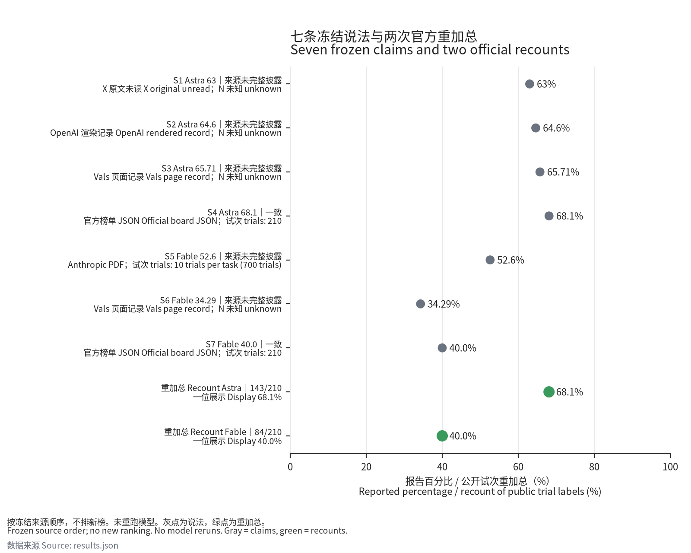

对已公开的70任务×3次试次标签的独立对账重加总得到：Astra 143/210=68.095238095238095238095238095238095238095238095238%（一位展示68.1%），Fable 5.1 84/210=40%（一位展示40.0%）；对官方68.1%／40.0%的内部判定分别为一致／一致，BenchLM镜像判定分别为一致／一致；本审计未重跑模型，判定只针对榜单展示值的算术相符，不涉及grader、任务字节、科学结论或谁更强。

This recount of released trial labels confirms the official displays: Astra 143/210 → 68.1%; Fable 5.1 84/210 → 40.0%. Both BenchLM rows match the frozen official values and every required provenance field. No models were rerun; no party is accused of wrongdoing.

这是对公开逐试次记录的重加总，不指控任何一方。已知基线曾在可行性查看中出现；AP 的相符只确认独立审计轨迹，不是未知发现。50 位 Decimal 字符串是计算近似，精确量由整数比给出。

公开锁定：[提交 acd553f7c989c1141424f8de33515727b4a61086](https://github.com/empac666/ai4science-recheck-tbscience-scores/commit/acd553f7c989c1141424f8de33515727b4a61086)。协议与可行性文件未改；公开可访问性已核验，首次 push 的事件时间未独立恢复，不能用作者日期冒充。See [public_lock.json](artifacts/public_lock.json).

A 直接按 task→trial 计数；B 从原始 JSON 重新解析并按 job→task 计数。两者不共享求和函数、不导入可行性脚本，逐任务、逐 job、总分子和分母全部相符。资格检查包括 70 唯一任务、五域 8/9/19/17/17、每 cell 三个 bool、系统内 trial 唯一、每 task 每 job 一条、三个 job 各 70 条及 cell/metrics/n_trials 字段。

Both independent implementations agree at task, job and total levels. All 14 frozen input byte counts and hashes match; only those cached inputs are used. Code hashes were frozen before formal execution. All five locked software versions match.

| Audit target / 审计项 | Result / 结果 |
|---|---|
| Astra naive stderr | computed 3.2164475807033744402736171221345012828064718505697; raw 3.2164475807033743; both → 3.2, display matches |
| Fable naive stderr | computed 3.3806170189140663100384733094637811705231435604538; raw 3.380617018914066; both → 3.4, display matches |

作者的 ±3.2/±3.4 是朴素标准误展示，不是 95% CI。AP-04 使用有理数验证平衡设计下任务等权与试次等权恒等。有限冻结集合计数没有抽样误差；下列区间仅描述任务簇重采样。These intervals do not establish population representativeness, external-score significance, causal superiority, or grading validity.

| Task-cluster bootstrap, percentage points / 任务簇区间 | Primary, non-stratified / 非分层主区间 | Stratified sensitivity / 分层敏感性 |
|---|---|---|
| Astra | [59.047619, 77.142857] | [59.047619, 76.666667] |
| Fable | [30.952381, 49.047619] | [31.428571, 49.047619] |
| Astra_minus_Fable_pp | [18.095238, 38.095238] | [18.571429, 38.095238] |

各 10,000 次，PCG64 种子 2026101001／2026101002，linear 2.5%／97.5% 分位数；task id 字典序，两系统共用抽样索引。非分层主区间按跨域经验任务分布抽 70 个簇；分层按冻结域顺序及原域数抽样。Replicate hashes and exact numerical outputs are in [results.json](results.json).

| Sensitivity / 敏感性 | Astra | Fable |
|---|---|---|
| earth | 19/24 | 9/24 |
| engineering | 19/27 | 13/27 |
| life | 34/57 | 22/57 |
| mathematical | 41/51 | 21/51 |
| physical | 30/51 | 19/51 |
| Five-domain equal weight / 五域等权 | 69.680369% | 40.535202% |
| pass@3: at least one success / 至少一次成功 | 57/70 = 81.428571% | 43/70 = 61.428571% |

五域等权改变任务权重，pass@3 改变指标；均不替代官方 pass@1。三个 job 的试次率及均值见 [job_counts.csv](job_counts.csv)，逐任务及逐任务/job 整数表见 [task_counts.csv](task_counts.csv) 与 [task_job_counts.csv](task_job_counts.csv)。Domain weighting and pass@3 are sensitivity summaries, not alternative leaderboard scores.

| Frozen claim / 冻结说法 | Source / 来源 | Display | One main label / 单一主标签 |
|---|---|---|---|
| S1 Astra | X original unread | 63% | 来源未完整披露 |
| S2 Astra | OpenAI rendered only | 64.6% | 来源未完整披露 |
| S3 Astra | Vals 09-11 announcement | 65.71% | 来源未完整披露 |
| S4 Astra | Official JSON | 68.1% | 一致 |
| S5 Fable | Anthropic PDF §8.7 | 52.6% | 来源未完整披露 |
| S6 Fable | Vals 09-11 announcement | 34.29% | 来源未完整披露 |
| S7 Fable | Official JSON | 40.0% | 一致 |

七说法主标签计数：{"来源未完整披露": 5, "一致": 2}；一手支撑 5/7。S1a 单列，不增加七说法分母。The five external comparisons (including supplementary S1a) all stop at priority 1 because necessary source/configuration/run-identity fields are missing. Known agent or trial-count differences remain factual columns, with no causal attribution.

AA 使用 mini-swe-agent；模型卡 10 次/任务（700）与官方 3 次/任务（210）不同。OpenAI “maximum at any effort”可能是整套固定 effort 最高分，也可能是逐任务跨 effort 包络线，原文不能区分。历史 Vals 公告只保留固定一个 harness、pass@1 的字面；没有具名 agent 或完整试次聚合公式。No current Vals method is used to fill historical gaps.

S1 原帖未读；S2 HTTP 403，仅渲染记录，不算原始字节一手支撑。S5 的 Last-Modified 是服务器修改字段，不证明出版或运行时间。All extracted fields, date types, evidence hashes and per-field states are in [claims_table.csv](claims_table.csv).

| Rational compatibility / 有理数兼容 | Authorized denominator / 分母资格 | Full numerator set / 完整分子集合 |
|---|---|---|
| S1a 63.3%, d=1 | N=210, same original document | [133] |
| S3 65.71%, d=2 | N=70, assumed N; not written in announcement | [46] |
| S3 65.71%, d=2 | N=210, assumed N; not written in announcement | [138] |
| S6 34.29%, d=2 | N=70, assumed N; not written in announcement | [24] |
| S6 34.29%, d=2 | N=210, assumed N; not written in announcement | [72] |
| S5 52.6%, d=1 | N=700, same original document | [368] |
| S4 68.1%, d=1 | N=210, same original document | [143] |
| S7 40.0%, d=1 | N=210, same original document | [84] |

全部由 for K in range(N+1) 和 Decimal 边界比较枚举；兼容分子不代表恢复试次。S1/S2 的 N 未写，不重构。46/70=138/210 与 24/70=72/210 不能鉴定统计单位。AA 内嵌小数与 133/210 在 15 位 HALF_UP 下相同，但整数交叉乘积确认它不是精确分数；这不解释未读的 S1。

浮点对照仅限计数 float 与 accuracy float，以 Decimal.from_float 记录实际二进制值；显示解释算法仅 HALF_UP/HALF_EVEN/DOWN。63 与 63.3 的同算法原像存在交集，仅为算术存在性，不解释未读原帖；完整端点、全部命中算法及冻结允许对比见 results.json。

最终 AP-01–AP-19 全部完成并与冻结预测相符。 主计数、两套 bootstrap、stderr、域/job/pass@3 汇总见上述记录。仍未完成或不可验证：S1 原文读取、S2 原始页获取、外部逐试次与运行身份、完整任务字节身份、grader 验证、Fable 单条详情（冻结 HTTP 404）。These unknowns are scope limits, not completed checks. Current Vals background has numerically equal Fable 40.00 but no established run identity; it is not treated as a mirror.

首轮 S1a 与 S5 提取代码发生实现错误，相应 AP observed=null、matches=false，解释停止；修正分别绑定摘要中的目标模型分数、排除 PDF 目录条目，再冻结代码重执行。首轮结果、全部代码及哈希保留于 [execution_01](artifacts/execution_01/)。这是看过首轮结果后的修正，不声称盲态。The first execution and corrected execution are both retained; no frozen source node, prediction, denominator, threshold or seed changed.

末轮辅助核对已限定正式 tasks/ 目录：冻结版本的 70 个任务名与 API 相符；早先误纳入 CI/归档样例的诊断与第二轮代码保留于 [execution_02](artifacts/execution_02/)。任务文件字节及每次运行身份仍未验证。The benchmark task-name check excludes repository test fixtures; it does not establish task-byte identity.

本次没有改变协议、阈值、分母或来源；[DEVIATIONS.md](DEVIATIONS.md) 记录执行偏离情况。[artifacts](artifacts/) 含逐输入校验、版本、预执行代码哈希、代码轨迹及公开锁定证据；第三方原始正文不入库。

图为自制对账图，按冻结来源顺序，不排新榜。英文与中文传播草稿分别见 [x_post.md](x_post.md)、[x_post_cn.md](x_post_cn.md)，均未发布。
